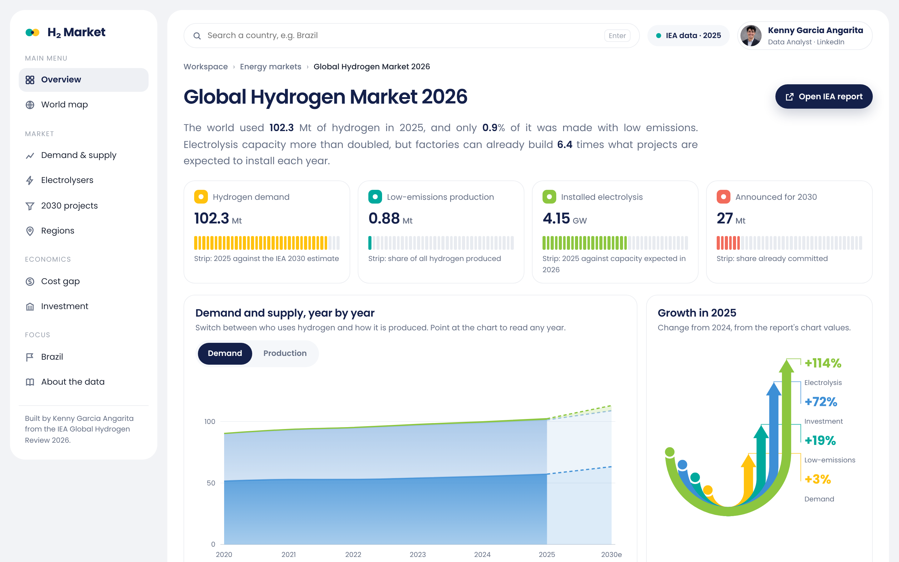

# H2 Market · Global Hydrogen Market 2026

An interactive dashboard of the global hydrogen market, built from the IEA **Global Hydrogen Review 2026**: who uses hydrogen and how it is made, how fast electrolysers are being installed, which 2030 projects are moving from announcement to reality, what low-emissions hydrogen costs, where the money goes, how countries depend on imported fertiliser, and where Brazil fits in.



**Demo video:** [`docs/demo.mp4`](docs/demo.mp4) (2.5 minutes, 1080p, subtitles only)

## How the story is told

The dashboard is built as a story, not only as a set of charts:

- **A hook:** *The factories are ready. The buyers are not.* Four questions in the header jump straight to the answers.
- **Why now:** the 2026 closure of the Strait of Hormuz doubled urea prices, and hydrogen sits behind most of the world's nitrogen fertiliser.
- **Five chapters:** the paradox, the exposure, promise vs reality, follow the money and Brazil's opportunity. Each ends with an insight and a link to the next one.
- **A guided tour:** eight steps that spotlight each chart in turn (arrow keys and Esc work too).
- **Numbers that count up** as they scroll into view, and a closing question for the reader.

## What's in the dashboard

| Section | What it shows |
| --- | --- |
| Overview | Four headline indicators (demand, low-emissions production, installed electrolysis, 2030 pipeline) and growth in 2025 |
| Demand & supply | Demand by sector and production by route, 2020–2025, with the IEA estimate for 2030 |
| Market shares | How clean, how concentrated and how committed the market is |
| World map | Urea and ammonia import dependence, methanol imports, progress to 2030 targets and the 2030 project pipeline by country, with a country card and a companion chart |
| 2030 projects | Funnel from announced to likely, committed and operating, split by electrolysis and fossil fuels with CCUS |
| Electrolysers | Installed capacity by region (2025 and under construction) and factory capacity against demand |
| Regions | Announced 2030 production by region as bubbles, plus a ranked table linked to the map |
| Cost gap | Production cost ranges by route, today and in 2030 |
| Investment | Spending on low-emissions hydrogen production by region |
| Brazil in focus | Fertiliser imports, Middle East exposure, Nova Indústria Brasil funding and the Latin American pipeline |

The country search in the top bar selects a country on the map; clicking a region in the table does the same.

## Headline numbers (2025)

- **102.3 Mt** of hydrogen used worldwide, up 3%; producing it emitted about **1 000 Mt CO₂**.
- Only **0.88 Mt** (under 1%) came from low-emissions routes.
- **4.15 GW** of electrolysers installed, **64%** of them in China. Factories can already build **58 GW** a year, against about **9 GW** a year of expected deployment to 2030.
- **27 Mt** of low-emissions production announced for 2030 (down from 37 Mt in last year's review), of which **4.3 Mt** is committed.
- **USD 6.65 bn** invested in low-emissions production; **66** countries have a hydrogen strategy.
- **Brazil** imports **8.3 Mt** of urea, the world's largest importer, and **40%** of its urea demand is met by Middle East imports.

## Data

All datasets are in `data/`, one JSON file each, with the report page in `scripts/build_data.py` and `data/key_facts.json`.

| File | Contents | Source |
| --- | --- | --- |
| `demand_by_sector.json` | Demand by sector, 2020–2025 and 2030 | Figure 2.1 |
| `production_by_route.json`, `production_by_region_2025.json` | Production by route and by region | Figure 3.1 |
| `low_emissions_production.json` | Low-emissions production by route and region | Figure 3.2 |
| `electrolyser_capacity.json`, `electrolyser_capacity_by_region.json` | Installed electrolysis | Figure 3.8 |
| `manufacturing_capacity.json`, `manufacturing_2030_announced.json` | Electrolyser factory capacity | Figure 3.11 |
| `pipeline_2030_by_status.json`, `pipeline_2030_by_region.json` | 2030 project pipeline, scaled so the total matches the 27 Mt in the report text | Figure 3.5 |
| `production_cost.json` | Production cost ranges | Figure 3.20 |
| `investment.json` | Investment by region | Figure 6.2 |
| `country_targets.json` | Progress towards national 2030 targets | Figure 7.3 |
| `import_dependence.json` | Urea, ammonia and methanol import dependence | Figure 1.2 |
| `key_facts.json` | Single figures quoted from the report text, with page numbers | Report text |
| `world_shapes.json` | Pre-projected (Natural Earth) country outlines | [world-atlas](https://github.com/topojson/world-atlas) |

Chart values were read from the report's vector graphics with `scripts/extract_chart.py` (bar heights calibrated to the axis ticks) and checked against the totals quoted in the text. Small rounding differences remain; 2030 figures are IEA estimates or announcements, not outcomes.

## Run it locally

```bash
npm install
node preview/server.js        # then open http://localhost:8767
```

To rebuild the data (needs Python with pdfplumber and the report PDF):

```bash
python scripts/build_data.py data
node scripts/build_world_shapes.mjs . data/world_shapes.json   # needs world-atlas, topojson-client and d3-geo
```

To record the demo video again (needs Playwright with Chromium and ffmpeg). The recorder opens `/?demo`, which adds the video's title cards, chapter cards and captions on top of the page:

```bash
node preview/server.js &
node preview/record_demo.js docs/demo.mp4
```

The page was written for a Claude Artifacts dashboard, which provides a small `dash` runtime (data loading, calculated values, drawings) and the `d3` global. `preview/server.js` supplies a minimal stand-in so the page runs anywhere.

## Source

IEA (2026), *Global Hydrogen Review 2026*, IEA, Paris. Licence: CC BY 4.0. This dashboard is an independent analysis of that report and is not endorsed by the IEA. Font: [Poppins](https://github.com/itfoundry/Poppins) (SIL Open Font License).

## Author

**Kenny Yusimy Garcia Angarita**, Data Analyst · [LinkedIn](https://www.linkedin.com/in/kennyyusimygarciaangarita/)

Other projects: [Brazil Election Panel](https://github.com/knnygarcia-git/Brazil-elections-2026-Panel) · [USA Election Panel](https://github.com/knnygarcia-git/USA-Elections-2026-Panel)
